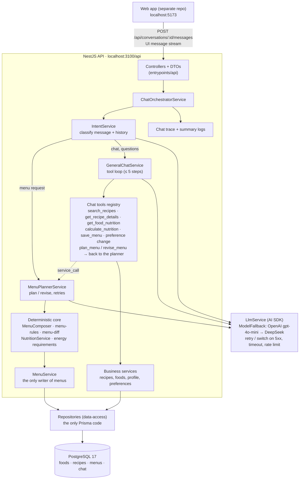
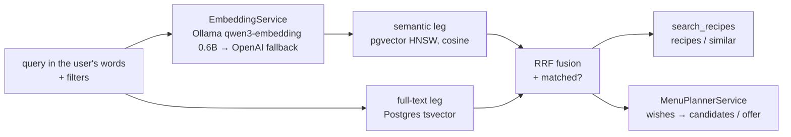

# Easy Cook backend

Menu planner API. NestJS 12 monolith · Prisma 7 (`pg` driver adapter) · PostgreSQL 17 (pgvector image) · class-validator · Jest 30 + Supertest · TypeScript 6 · ESLint 10.
Structure: `configs/`, `common/`, `providers/`, `modules/data-access`, `modules/services`, `entrypoints/api`.
The web app lives in its own repository.

A chat assistant that plans a weekly menu from real recipes and computes its nutrition. You ask
"make me a vegetarian menu for 3 days without mushrooms", it builds a menu that meets your daily
calories, diet and allergies, then lets you revise a day or a meal ("another dinner on Wednesday"),
answers questions about recipes and foods, and saves the menu when you confirm it.

The LLM never has the last word: it only picks recipe ids from the candidates the backend gives it,
and every menu goes through deterministic code (composition, menu rules, nutrition maths, the diff
of a revision) before it is saved. The prompts are measured by evals on the real models.

Sign-in with Google (an httpOnly session cookie in Redis), every user with their own profile, menus
and chats; the food and recipe catalog is shared and read only (seeded). See [Auth and security](#auth-and-security).

## Architecture



- **Intent first.** Each message is classified with the recent history (structured output):
  small talk and questions go to the tool-calling chat, a clear menu request (restated from the
  conversation) to the planner, a vague one gets a clarification with the missing fields.
- **Planner.** Every day has breakfast, lunch, snack and dinner (25 / 35 / 10 / 30 % of the daily
  calories). The model gets the candidates of each meal by short ids (`b1`, `s2`); a plan with
  wrong days, unknown ids or rule errors goes back to it with its problems, up to
  `MENU_PLAN_MAX_ATTEMPTS` calls. A revision may change only the parts it names (`menu-diff.ts`).
- **Tools.** Read tools return data through the services; `plan_menu` / `revise_menu` are only
  recorded and run on the planner path; errors go back to the model, never a 500.
- **Recipe search (RAG).** `search_recipes` and the wishes of a menu request ("more fish") find
  recipes by meaning in English or Ukrainian: hybrid pgvector + full-text search, see
  [Recipe search (RAG)](#recipe-search-rag).
- **Resilience and observability.** Pinned model snapshots, provider fallback, every prompt
  versioned (`name@vN`), one summary line per message (time, first text, calls, tokens), and with
  `ENV=local` a full JSON trace of the chain.

## Eval results

Every suite runs on the real model, each case 3 times; a prompt change must not fall below the
committed baseline (`evals/baselines/`). Pass rates of the current baselines:

| Suite           | What it checks                                                                         | Cases | gpt-4o-mini (main) | deepseek-flash (fallback) |
| --------------- | -------------------------------------------------------------------------------------- | ----: | -----------------: | ------------------------: |
| `intent`        | routing of a message: intent, days, constraints, revision targets, wishes and the answer to a wish offer (uk / en / surzhyk) |    85 |         **93.3 %** |                **91.8 %** |
| `clarification` | a vague request asks exactly for what is missing (LLM judge: Claude Haiku 4.5)         |    25 |             97.3 % |                    92.0 % |
| `menu-plan`     | 1-7 day menus: right days, only candidates, rules, calories ±15 %, dislikes, variety   |    22 |             97.0 % |                    84.8 % |
| `menu-day`      | revising a day / meal / several parts: nothing outside the scope changes, constraints  |    38 |            100.0 % |                   100.0 % |
| `chat-tools`    | the right tool with valid arguments, no tool for small talk, plan / revise handed over, recipe search by meaning |    52 |             98.1 % |                    99.4 % |

Measured on `intent@v6` and `general-chat@v6`. Details of each suite and the runner: [Evals](#evals).

## Quick start

Requires Node 24 (`nvm use`), Docker, and an OpenAI key (DeepSeek optional, as the fallback).

```bash
nvm use
cp .env.example .env          # set OPEN_AI_API_KEY, GOOGLE_CLIENT_ID, AUTH_SECRET, AUTH_ALLOWED_EMAILS
npm install                   # also generates the Prisma client
npm run infra:up              # postgres on localhost:5442, redis on localhost:6389
npm run db:seed               # ~520 foods + 300 recipes from data/seed (idempotent)
npm run start:dev             # applies migrations; API on http://localhost:3100/api, Swagger on /docs
# or everything in docker:
npm run compose
```

Then start the web app (`../easy_cook.frontend`, `npm run dev`, http://localhost:5173), fill in the
sign in with Google, fill in the profile, calculate the daily goal and ask the chat for a menu. Every
route but `/api/health` and the sign-in needs the session cookie, so use the web app (or Swagger after
signing in there).

Check everything: `npm run lint && npm run type-check && npm test && npm run test:e2e && npm run build`.
Run the evals (costs a few cents per suite): `npm run eval`, `npm run eval -- --provider deepseek`,
or only what your changes touch: `npm run eval -- --changed-since origin/main` (what CI runs on a
pull request).

## Ports

| Service  | Host port |
| -------- | --------- |
| API      | 3100      |
| Postgres | 5442      |
| Redis    | 6389      |
| Ollama   | 11434     |

## Auth and security

- **Sign-in:** `GET /api/auth/nonce` (a one-time nonce, 10 min, also an httpOnly cookie) -> Google
  Identity Services in the web app with that nonce -> `POST /api/auth/google { idToken }`. The ID token
  is verified against Google's keys, `GOOGLE_CLIENT_ID` (audience), the issuer, the expiry, a verified
  email and the nonce of this browser, used once (no replayed or foreign token). A new user only for
  an email in `AUTH_ALLOWED_EMAILS`; a user in the database (the owner, added by the
  `add_users` migration) may always sign in.
- **Session:** a random 256-bit token in an httpOnly, Secure, `SameSite=Strict`, host-only cookie
  (`__Host-ec_session`); Redis keeps only its sha256. It ends after 7 days unused, 14 days after the
  sign-in, on `POST /api/auth/logout`, or when the user is deleted;
  every sign-in gets a new token, at most 10 sessions per user. `GET /api/auth/session` -> the user and
  the CSRF token. Redis down -> 503, never 401.
- **CSRF:** every unsafe request needs `X-CSRF-Token` (an HMAC of the session with `AUTH_SECRET`), an
  allowed `Origin` (`CORS_ORIGINS`; `*` means localhost only and only with `ENV=local`, every
  other environment lists its origins) and a JSON body (415 otherwise).
- **Rate limits** (Redis, in process memory while Redis is down): a signed-in client by its email,
  any other by its IP, an IPv6 one by its /64 (`TRUST_PROXY_HOPS` behind a proxy). Every route
  300 / min signed in, 60 / min anonymous; a chat message (the model) 5 / min, past which the
  client is blocked from that limit for 5 min signed in, an hour anonymous. The sign-in: 3 failed
  attempts per 15 min (a success clears them), then 30 min blocked. A blocked request is not counted;
  `Retry-After[-<limit>]` says when to retry.
- **Headers:** helmet (`Referrer-Policy: no-referrer`, HSTS, frame denial, ...) and
  `Cache-Control: no-store` on every response.

### From scratch

```bash
nvm use && cp .env.example .env && npm install
npm run infra:up
npm run db:reset              # drops everything, applies migrations, seeds
# or: docker compose down -v && npm run infra:up && npm run migration:run && npm run db:seed
npm run db:seed               # second run: "0 created, N updated", same ids and counts
npm run data:import-foods -- --dir data/raw/<FDC folder>   # optional, see "Datasets"
npm run data:verify           # FK integrity, duplicates, control recipes, counts; exit 1 on failure
npm run start:dev             # API on http://localhost:3100/api
```

The web app (`../easy_cook.frontend`, `npm run dev`) runs on http://localhost:5173; its dev server
proxies `/api` to port 3100, as `npm run preview` (http://localhost:4173) does. `CORS_ORIGINS` lists
the web app origins: `.env.example` has both local ones; production lists the web app URL (e.g.
`https://app.example.com`). `*` means any localhost and is refused outside `ENV=local`.

Requires Node 24 LTS (`.nvmrc`; run `nvm use`). NestJS 12 ships as ESM and the project is CommonJS:
Node loads it through `require(esm)`, and Jest needs `--experimental-vm-modules` for the same
(already in the `test*` scripts).

## Database

The schema is `prisma/schema/` (`schema.prisma` holds the generator and datasource, the models are split by domain); migrations live in `prisma/migrations` and are applied on
start-up (`prisma migrate deploy`). The CLI reads `DATABASE_URL` through `prisma.config.ts`; the
client is generated into `src/generated/prisma` (git-ignored) on `npm install` and connects through
`@prisma/adapter-pg`.

```bash
NAME=add-something npm run migration:create   # new migration from schema changes (review the SQL)
npm run migration:dev                         # create + apply in one go
npm run migration:status
npm run db:reset                              # drop everything, re-apply migrations, seed
```

| Table                                               |                                                                                                                                       |
| --------------------------------------------------- | ------------------------------------------------------------------------------------------------------------------------------------- |
| `user_profiles`                                     | age, height, weight, sex, activity level, goal                                                                                        |
| `nutrition_goals`                                   | daily kcal / protein / fat / carbs; append-only, `manual` or `rule_based` + `rule_version`                                            |
| `dietary_preferences`                               | diet, allergy, disliked food, excluded ingredient                                                                                     |
| `food_items`                                        | values per 100 g **in a given state** (raw, dried, boiled...); null = unknown; unique `source + source_id`                            |
| `recipes`                                           | meal type, diet tags (`varchar[]`), servings; unique `source + source_id`                                                             |
| `recipe_ingredients`                                | grams for the whole recipe, optional flag, notes, display order                                                                       |
| `menus`, `menu_versions`, `menu_days`, `menu_meals` | immutable versions with snapshots of the goal, recipes and nutrition; `menus.confirmed_version_id` is set only by an explicit confirm |
| `conversations`, `messages`                         | chat with the assistant; a message may link a `menu_version_id`                                                                       |

Enum-like columns are `VARCHAR`; allowed values are in `src/common/constants` and are validated by
the API (`GET /api/profile/options` lists them).

## Nutrition

`NutritionService` is plain deterministic maths, no database and no LLM:

```
value = quantity_g / 100 × nutrient_per_100g
recipe = Σ ingredients        per serving = recipe / servings
```

- The state matters: 150 g of **dry** rice and 150 g of **boiled** rice are different food items
  with different values. Pick the food that matches what is weighed.
- Optional ingredients are left out unless `?includeOptional=true`.
- An unknown value counts as 0 and is reported in `missing`; the result is then `complete: false`.
- Totals are the sum of the ingredients (`basis: "ingredients_sum"`), not a lab value of the
  cooked dish: water loss and oil left in the pan are not accounted for.

Daily targets (`POST /api/nutrition/goals/calculate`): Mifflin-St Jeor BMR × activity factor,
-15 % / +10 % for lose / gain, protein 1.6–2.0 g/kg, fat 25 % of kcal, carbs the rest
(`src/modules/services/nutrition-goal/energy-requirements.ts`, version `mifflin-st-jeor-v1`).
These are reference values for meal planning, not medical advice.

## Recipe search (RAG)

Recipes are found by what the user means, not only by name: "something light with chicken",
"суп із сочевиці", "more fish this week". Design notes, the model choice and the production plan:
[`docs/notes/rag-recipe-search.md`](docs/notes/rag-recipe-search.md).



- **One recipe = one document** (`buildRecipeDocument`): name, description, meal, diets, time,
  ingredients and the method in English, then the Ukrainian name, description and ingredients
  from `recipe_translations`. One vector per recipe, `vector(1024)`, keyed by model
  (`provider/id@dims`), so two models never mix.
- **Hybrid search** in one SQL query: the semantic leg (HNSW, iterative scan) and the full-text
  leg (any word, words of 3+ letters), both pre-filtered by meal, diets, allergens and time, fused
  by Reciprocal Rank Fusion. No embedding provider → full-text alone (`degraded`).
- **Found or only similar.** A search `matched` when its best recipe reaches the calibrated
  `matchSimilarity` of the model (0.50 for the local one) or a recipe has every word of the
  query. Otherwise the hits are only similar ("sushi" finds a poke bowl):
  - `search_recipes` returns no `recipes`, only `similar`, and the chat says the app has no such
    recipe and may offer the similar ones, asking first;
  - the planner plans no menu for wishes nothing fits: it offers the closest recipes
    (`data-wish-offer`, kept in `messages.wish_offer`) and waits for the answer, a message ("yes,
    take them") or a button of the web app (`wishOffer: accept | decline` with the message).
- **Embedding models**: local Ollama `qwen3-embedding:0.6b-q8_0` first, OpenAI
  `text-embedding-3-large` (1024 dims) when it is down (`EMBEDDING_PROVIDERS`, `OLLAMA_BASE_URL`).
  Specs and e2e never call a model (`src/test/fake-embeddings.ts`).

```bash
npm run infra:embeddings            # Ollama in docker (or the native app: faster on a Mac)
ollama pull qwen3-embedding:0.6b-q8_0   # native app only
npm run search:index                # embeds new and changed recipes (by content hash)
npm run search:index -- --status    # how many recipes every model has
npm run eval:retrieval              # Recall@k, nDCG@k, MRR, match / no-match per mode
```

Retrieval evals (`evals/retrieval/`, 48 cases: en, uk and 13 dishes the catalog lacks), local model,
hybrid mode: nDCG@10 **0.90** (en 0.90, uk 0.91), Hit@3 1.00, `match` 0.89 (a query with answers
is found), `no-match` 0.92 (a dish the catalog lacks is not passed off as found). A change of the
document or the search must not fall below the baseline in `evals/retrieval/baselines/`.

Prisma cannot declare the HNSW index: `NAME=... npm run migration:create` takes its `DROP INDEX`
out of a new migration; never run a bare `prisma migrate dev`.

## API

Everything is under `/api`; Swagger UI on `/docs`.

| Method               | Path                                                                       |                                                                                                                                                                                                                                                                                                                                                                                                                                                                                      |
| -------------------- | -------------------------------------------------------------------------- | ------------------------------------------------------------------------------------------------------------------------------------------------------------------------------------------------------------------------------------------------------------------------------------------------------------------------------------------------------------------------------------------------------------------------------------------------------------------------------------ |
| GET                  | `/health`                                                                  | 503 when the database or Redis is down                                                                                                                                                                                                                                                                                                                                                                                                                                                      |
| GET / PUT / PATCH    | `/profile`                                                                 | the single profile; `GET` is 404 until `PUT`                                                                                                                                                                                                                                                                                                                                                                                                                                         |
| GET                  | `/profile/options`                                                         | allowed values of every enum-like field                                                                                                                                                                                                                                                                                                                                                                                                                                              |
| GET                  | `/nutrition/goals`, `/nutrition/goals/current`, `/nutrition/goals/preview` | history (newest first), goal in effect, rule based targets without saving                                                                                                                                                                                                                                                                                                                                                                                                            |
| POST                 | `/nutrition/goals`                                                         | manual goal (optional future `effectiveFrom`)                                                                                                                                                                                                                                                                                                                                                                                                                                        |
| POST                 | `/nutrition/goals/calculate`                                               | rule based goal from the profile                                                                                                                                                                                                                                                                                                                                                                                                                                                     |
| GET / POST           | `/preferences`                                                             | values are trimmed and lower-cased; `diet` must be a diet tag                                                                                                                                                                                                                                                                                                                                                                                                                        |
| DELETE               | `/preferences/:id`                                                         |                                                                                                                                                                                                                                                                                                                                                                                                                                                                                      |
| GET                  | `/foods?search=&state=&source=&page=&limit=`                               | search matches `name` and `nameEn`                                                                                                                                                                                                                                                                                                                                                                                                                                                   |
| GET                  | `/foods/:id`                                                               |                                                                                                                                                                                                                                                                                                                                                                                                                                                                                      |
| GET                  | `/recipes?search=&mealType=&dietType=&page=&limit=`                        | `dietType` repeated or comma separated: the recipe has every tag                                                                                                                                                                                                                                                                                                                                                                                                                     |
| GET                  | `/recipes/:id`                                                             |                                                                                                                                                                                                                                                                                                                                                                                                                                                                                      |
| GET                  | `/recipes/:id/nutrition?includeOptional=`                                  | per ingredient, total, per serving                                                                                                                                                                                                                                                                                                                                                                                                                                                   |
| GET                  | `/menus?status=`                                                           | confirmed menus by default; `status=draft` the ones without a confirmed version, `all` both                                                                                                                                                                                                                                                                                                                                                                                          |
| GET                  | `/menus/:id`                                                               | every version, newest first, nutrition per meal and day, issues                                                                                                                                                                                                                                                                                                                                                                                                                      |
| PATCH / DELETE       | `/menus/:id`                                                               | rename / delete                                                                                                                                                                                                                                                                                                                                                                                                                                                                      |
| POST                 | `/menus/:id/versions/:versionId/confirm`                                   | for a chat menu, the ids of the reply (`data-menu` `menuId` / `versionId`, or the message's `menuId` / `menuVersionId`); rechecked against the current preferences first, 400 when it breaks diets / allergies / excluded foods (the confirmed version stays); another version replaces the confirmed one; returns the menu. Contract in Swagger (`/docs`)                                                                                                                           |
| GET / POST           | `/conversations`                                                           |                                                                                                                                                                                                                                                                                                                                                                                                                                                                                      |
| GET / PATCH / DELETE | `/conversations/:id`                                                       |                                                                                                                                                                                                                                                                                                                                                                                                                                                                                      |
| POST                 | `/conversations/:id/messages`                                              | at most 300 characters; saves the message and streams the reply (AI SDK UI message stream): text, `data-menu` (`menuId`, `versionId`, `composition`), `data-clarification` with the missing fields, or `data-error` (`code`, `message`, `retryable`) + `error`; the reply is saved once complete. Every generated menu is saved as an unconfirmed version (`generatedBy: llm`): the first one of the conversation as a new menu linked to it, the next ones as versions of that menu |

Errors always look like `{ statusCode, message, error, path, timestamp }`.

## Datasets

Large datasets are **not** committed: `data/raw/` and `data/processed/` are git-ignored.
Sources, licences (USDA FDC: public domain, CC0 1.0) and the update procedure:
[docs/data-sources.md](docs/data-sources.md).

| Path                             |                                                                                         |
| -------------------------------- | --------------------------------------------------------------------------------------- |
| `data/seed/foods.json`           | ~45 base foods, values per 100 g (rounded USDA values), committed                       |
| `data/seed/usda-foods.json`      | 478 USDA foods (Foundation + SR Legacy) with full macros, committed                     |
| `data/seed/recipes.json`         | 12 recipes using those foods (`food` = slug, or `usda_fdc:<fdc_id>`), committed         |
| `data/seed/menu-recipes.json`    | 288 more recipes in the same format, committed                                          |
| `data/seed/food-categories.json` | categories of the foods the recipes use (`meat`, `dairy`, `gluten_grain`...), committed |
| `data/seed/food-aliases.json`    | ingredient name aliases (`scallion` -> `usda_fdc:170005`), not loaded                   |
| `data/seed/control-recipes.json` | hand-computed nutrition of 3 seed recipes (arithmetic included), committed              |
| `data/raw/`                      | downloaded datasets                                                                     |
| `data/processed/`                | normalized output of the import                                                         |

```bash
npm run data:validate        # checks data/seed without a database (ranges, references, 4/9/4 kcal, control recipes)
                             # and lists the rejected recipes with the reasons (import rules below)
npm run data:classify        # recipe diet tags and allergens from the food categories, and where
                             # they differ from the tags of the recipe files (--all: every recipe)
npm run data:coverage        # recipes per meal type for every derived diet (vegan, vegetarian,
                             # pescatarian, gluten_free, dairy_free); exit 1 below 14 breakfasts,
                             # lunches or dinners per diet (two weeks without a repeat)
npm run db:seed              # upserts seed foods, USDA foods of usda-foods.json and recipes
npm run data:seed-recipes    # recipes only (the foods must already exist)
npm run data:verify          # checks the database: orphan rows per FK, duplicated source ids,
                             # recipes without ingredients, imported recipes against the import rules,
                             # control recipes via NutritionService, counts
```

Import rules of a recipe (`scripts/lib/recipe-rules.ts`): it has an instruction, every ingredient is
matched to a food (with categories, for the seed), the counted ingredients have every nutrient
value, and one serving is 50-2500 kcal (`IMPORT_SERVING_KCAL`). A recipe that breaks one is not
seeded and is listed as `rejected <slug>: <reasons>`; `data:validate` then exits with 1.

### USDA FoodData Central

1. Download **Foundation Foods — CSV** (optionally **SR Legacy — CSV**) from
   https://fdc.nal.usda.gov/download-datasets and unzip it into `data/raw/`.
2. Import (upserts by FDC id, safe to repeat):

   ```bash
   npm run data:import-foods -- --dir data/raw/FoodData_Central_foundation_food_csv_2026-04-30
   # options: --data-types foundation_food,sr_legacy_food   --dry-run   --out data/processed/usda-foods.json
   ```

The importer reads `food.csv` and `food_nutrient.csv` (+ the calorie conversion factor files when
present), keeps the chosen data types, and maps: energy 1008 → 2048 → 2047 → the food's own
calorie factors → 4/9/4; protein 1003; fat 1004 → 1085; carbs 1005 → 1050. The state is detected
from the description (`raw`, `boiled`, `dry`...). Names are English (`name` = `name_en`).

## Evals

Prompt quality measured on the real model (`OPEN_AI_API_KEY`, `ANTHROPIC_API_KEY` for the judge,
costs money: the intent and menu-plan suites are ~$0.02 a run each). Not part of `npm test`;
run it before and after a prompt change, on OpenAI and on the DeepSeek fallback.

```bash
npm run eval                                   # every suite, compared with its baseline
npm run eval -- --suite intent                 # one suite (comma separated or repeated)
npm run eval -- --suite intent --save-baseline # record the current result as the baseline
npm run eval -- --repeat 1 --concurrency 3     # runs per case (3 by default), parallel calls (5)
npm run eval -- --provider deepseek            # the fallback model (DEEPSEEK_API_KEY)
npm run eval -- --suite chat-tools --tag save  # only the cases with any of the tags (repeatable)
npm run eval -- --changed-since origin/main    # only what the changes since the ref touch
```

- `--tag` runs the cases with any of the tags and compares only the rates of those tags with the
  baseline (the pass and field rates of the whole suite say nothing about a part of it); a suite
  without such a case is skipped. Baselines are saved from whole suites only.
- `--changed-since <ref>` diffs the working tree with the merge base of the ref and runs a suite
  whole when its prompt versions or model differ from its baseline or its folder under
  `evals/suites/` changed, and the suites or tags of `evals/suites/triggers.ts` (path prefix ->
  suites, tags) for the other files; specs and code no suite runs change nothing. A new path a
  suite depends on goes into the triggers; `triggers.spec.ts` checks every path, suite and tag.
- CI (`.github/workflows/evals.yml`, secrets `OPEN_AI_API_KEY`, `ANTHROPIC_API_KEY`,
  `DEEPSEEK_API_KEY`): a pull request runs `--changed-since origin/<base>`; a manual run
  (Actions -> Evals -> Run workflow) takes the suites, tags, provider and repeats. The reports are
  the `eval-reports` artifact of the run.

- A run measures one provider without fallback (`--provider`, openai by default). The baselines of
  OpenAI are in `evals/baselines/`, of a fallback in `evals/baselines/<provider>/`.
- The models are pinned: `gpt-4o-mini-2024-07-18`, `deepseek-flash` (DeepSeek has no dated
  snapshots; its baseline catches a change) and the judge `claude-haiku-4-5-20251001` at
  temperature 0 (`evals/lib/judge.ts`).

- `evals/suites/<name>/cases.jsonl` - one case per line: `id`, `tags`, the input and `expected`.
  `evals/suites/<name>/<name>.suite.ts` runs a case through the same code the app uses and scores
  every field of the answer.
- The console prints the pass rate, the rate of every field and tag, the mean and maximum of
  every metric of the suite, tokens, latency (mean, p50, p95), cost and the failed cases; the full report goes to `evals/reports/` (git-ignored).
- `evals/baselines/<suite>.json` is committed. A run is worse - exit code 1 - when the pass rate or
  a field rate drops more than two standard errors below it (one run at least); the same prompt
  does not give the same answers every run, and every case runs 3 times to even that out. Exit
  code 1 also when the run used another model than the baseline (save a new one).
- Every prompt has a version (`ModelPrompt` in `src/common/constants/open-ai.ts`, `name@vN`). The
  report and the baseline name the prompt versions of the suite, and the console prints
  `baseline   prompts intent@v1 -> intent@v2` when a run measured other versions than the baseline.
- Output that does not match the schema fails the case. A failed call (timeout, rate limit) is
  left out of the rates; more than 10 % of them fail the run as incomplete, and `--save-baseline`
  saves nothing after any.
- The runner logic lives in `evals/lib/` with specs, which run with `npm test`.

**intent** - the classifier of chat messages (`IntentService`, with the rules of `resolveIntent`):
76 messages in Ukrainian and English (direct, vague, more than 7 days, no days, surzhyk, out of
scope, general chat, follow-ups, menu revisions). Fields: `intent`; `days` from `menuRequest`;
`constraints` read from the restated request; `target`: the targets of a revision in any order,
one for each (their scope and the fields the case sets), read as the app reads them on the menu of
`menuDays` days (`readTargets`). A constraint lists alternatives: `"vegetarian"` must be named as wanted, `"!meat"` as
excluded ("without meat", "meat-free"). The baseline was taken on the prompt before CHAT-1, which
must not be worse.

**menu-plan** - the menu planner with its retries (`menuPlanModelCall`, `planWithRetries`, as
`MenuPlannerService` runs them) on the seed recipes (`recipes.json`: their snapshots with the
nutrition per serving dumped from a seeded database and the ingredients of `data/seed`; refresh it
when the seed recipes change): every number of days from 1 to 7, and 1, 3 and 7 days for the
profiles without restrictions (`basic`), `vegan`, `allergy` (peanut, egg; dislikes mushrooms) and
`low_kcal` (1400 kcal; dislikes salmon), plus `vegetarian` and several candidate rotations. The
fields score the last plan: `days` (exactly the days asked for), `candidates` (only ids of the
candidates of that meal), `validation` (no problem the planner sends back to the model),
`calories` (every day within 15 % of the goal, the servings fitted to it by `fitServings`), `disliked` (no disliked food), `variety` (no
recipe on two days in a row, none twice while the meal has unused candidates). The metric
`repairs` is the mean of the calls after the first one; it is saved in the baseline, not compared.

**menu-day** (EVAL-5) - revising a suggested menu as `MenuPlannerService.replan` does
(`replaceParts` with `planWithRetries`): a day, a meal, several parts in a request ("redo
Tuesday", "another dinner on Wednesday", "redo Monday and Thursday", "redo Tuesday and the dinner
on Friday"), a constraint the request adds (`rules`: "redo Tuesday without beef" also replaces the
meals of other days that break it, `violatingSlots` and `widenReplacement`) and the whole menu
(every day named or widened to: `MENU_PLAN_PROMPT`), on the same recipes and profiles: menus of 2
to 7 days given by recipe names, the first, a middle or the last day, every kind of meal, and
targets the backend collapses (every meal of a day is the day, a day with a meal of it is the day;
`resolveReplaceTarget`). Every part
is planned on the menu the parts before it made: the candidates of a day leave out its own
recipes, then those of the other days, then the rejected ones (`withoutRecipes`, a step given up
for a meal it would leave empty), those of a meal are the recipes of that meal the menu does not
serve yet (`mealRecipes`), then not rejected, that keep the day within its calories
(`fittingDayKcal`). Rejected are the recipes earlier versions of the menu had and the current one
has not (`MenuService.getRevisionBase`), and those of the parts replaced earlier in the request. Fields:
`replacement` (the days and meals replaced, for the cases that expect them); `candidates`;
`unchanged` (the diff of the versions, `changedSlots`, within the parts replaced: everything else
byte for byte as in the previous one; `replan` checks the same diff and throws on a change
outside them); `exclusions`, but for the whole menu (no recipe the menu already serves, or a
replaced day had, while the meal had another one, not counting meals the request replaced);
`validation` (no error in the whole new menu, the rules the request adds included); `calories` of every day changed and
`disliked` of the new meals. Metric `repairs`.

## Tests

```bash
npm test            # unit tests (Jest, *.spec.ts next to each file, incl. scripts/lib)
npm run test:cov    # + coverage report in ./coverage
npm run test:e2e    # Supertest against TEST_DATABASE_URL (created, migrated and wiped automatically)
npm run lint
npm run type-check
```

Shared helpers live in `src/test/`: `createMock<T>()` (auto-mocks every method),
`createPrismaMock()` (every model delegate), `fakeConfig()`, fixtures (`buildFoodItem`,
`buildRecipe`, `buildProfile`...). Every new piece of code ships with its spec.
